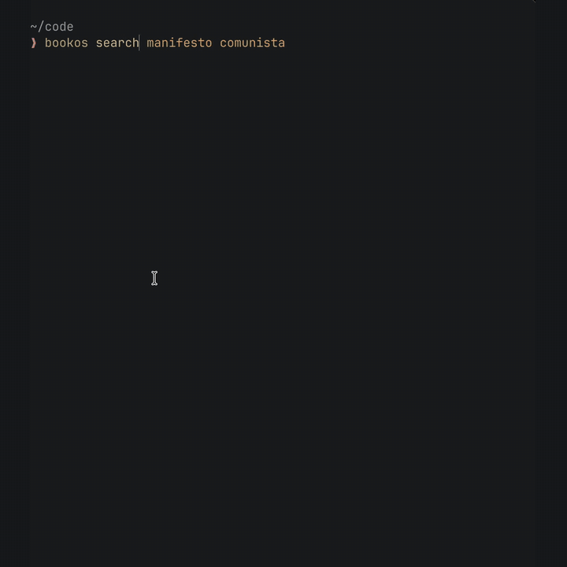

# bookos

A command-line tool to search and download books from [Anna's Archive](https://annas-archive.gl) and Libgen, send them to your Kindle, and search from KOReader.



[Watch in full quality (MP4)](assets/demo.mp4)

```
$ bookos search dom casmurro -f epub -l pt -n 3
  1  Dom Casmurro (Prazer de Ler) (Portuguese Edition)
     de Assis, Machado · 2016 · pt · epub · 0.5MB · lgli/zlib
     6929bd3a14ab735fbd2c7a190d8728fb
  2  Dom Casmurro
     De Assis, Machado · 2000 · pt · epub · 0.3MB · lgli/lgrs/zlib
     db3ba212ff208c9ebad4b3bd88bba98e
  ...

download with: bookos download <number>

$ bookos download 1
Dom Casmurro (Prazer de Ler) (Portuguese Edition)
de Assis, Machado
aa-slow: getting the link from server #1…
  Please wait 52 seconds to download this file
aa-slow: downloading…
  0.4 MB  done
saved to ~/Downloads/de Assis, Machado - Dom Casmurro (Prazer de Ler) (Portuguese Edition) (2016).epub
```

## What it does

- **Search** goes through Anna's Archive, which indexes Libgen (.rs and .li), Z-Library, Sci-Hub, the Internet Archive lending library, DuXiu, HathiTrust and direct uploads. Each result shows title, author, publisher, year, language, format, size, the collections that hold the file, and its md5.
- **Download** identifies a file by its md5 (the same across all these libraries) and tries the sources in order until one works:
  1. `aa-fast`: the official Anna's Archive fast download API. Needs a membership secret key; skipped otherwise.
  2. `aa-slow`: the free "slow partner server" download. It runs through Chrome, waits out the queue countdown, grabs the signed download link and fetches the file over plain HTTP.
  3. `libgen`: the Libgen.li family of mirrors (`ads.php` → `get.php`).
- Every download is **checked against its md5**. A mismatching file is discarded.
- Interrupted downloads **resume**: the partial file is kept as `<name>.part`. Run the same command again to continue it with an HTTP `Range` request.
- Files are saved as `Author - Title (Year).ext`.

## Requirements

- macOS
- Google Chrome installed at `/Applications/Google Chrome.app`
- Rust 1.88 or newer (edition 2024), to build it

## Install

```
cargo install --git https://github.com/muricristino/bookos
```

Or from source:

```
git clone https://github.com/muricristino/bookos
cd bookos
cargo build --release
cp target/release/bookos ~/.local/bin/
```

## Usage

### Search

```
bookos search <terms...> [-f FORMAT] [-l LANG] [--by author|title] [-p PAGE] [-n MAX] [--json]
```

| Flag | Description |
|---|---|
| `-f, --format` | File format: `pdf`, `epub`, `mobi`, `azw3`, `djvu`… |
| `-l, --lang` | Language code: `en`, `pt`, `es`… |
| `--by` | Match the terms against the `author` or the `title` only |
| `--sort` | Order: `newest`, `oldest`, `largest`, `smallest`, `newest_added`, `oldest_added`. With a sort the terms can be left out |
| `-p, --page` | Results page from Anna's Archive (default 1) |
| `-n, --max` | How many results to show (default 10) |
| `--json` | Print results as JSON |

The terms can be a title, an author, an ISBN, or an md5. The results are saved to `~/.config/bookos/last-search.json`, so you can download by number afterwards.

```
bookos search the left hand of darkness
bookos search 9788525054463
bookos search machado de assis -f epub -l pt -n 20
```

### Store

```
bookos store [shelf] [--refresh] [-n MAX] [--json]
```

Anna's Archive has no categories or best-seller lists, so the store builds shelves from other catalogs and keeps only the books it can download, in your language (`store_lang`, default `pt`) and in epub:

| Shelf | Where the books come from |
|---|---|
| `new` | The newest additions to Anna's Archive in your language |
| `brazilian-fiction`, `fantasy`, `mystery`, `russian-classics` | [Open Library](https://openlibrary.org) subjects, using the title of the edition in your language |
| `more-<author>` | The authors you have most books by, read from the Kindle over ssh (or from the bookos downloads) |
| your own | Lists in `~/.config/bookos/shelves` |

Books you already have are left out. Without a shelf, `bookos store` lists the shelves. A shelf is built the first time you open it (it takes a minute or two, one search per book) and is cached for a day in `~/.cache/bookos/store`. The results are saved like a search, so `bookos download <number>` works after it.

Your own shelves are plain text: a `#` line starts a shelf, and each line under it is `title | author`:

```
# Russian classics
Crime e castigo | Dostoiévski
Anna Kariênina | Tolstói
```

### Info

```
bookos info <n|md5> [--json]
```

Shows a book's page from Anna's Archive: title, author, publisher, the description, and other publishers, editions and titles it is known by.

### Pages

```
bookos pages [n|md5] [--isbn ISBN] [--title T] [--author A] [-l LANG] [--publisher P] [--json]
```

Finds how many pages the printed book has, from [Open Library](https://openlibrary.org). With an ISBN it starts from that exact edition; otherwise it looks the title up and lists the editions in that language with a page count, putting first the one from the same publisher, or else the one closest to the median. A result number or md5 fills in the title, author, language and publisher.

### Download

```
bookos download <number|md5> [-d DIR] [--source SOURCE]
```

| Flag | Description |
|---|---|
| `-d, --dir` | Destination directory (default `~/Downloads`, or `dir` from the config) |
| `--source` | Use only this source: `aa-fast`, `aa-slow` or `libgen` (a comma-separated list also works) |

```
bookos download 2                                   # result #2 from the last search
bookos download 7efc25320899bd1151b6ef1c8d41b6cc    # any md5, looked up on Anna's Archive
bookos download 1 -d ~/Books --source libgen
```

### Send to Kindle

```
bookos kindle <file|number|md5> [--via email|usb|ssh] [-d DIR]
bookos download <number|md5> --kindle
```

A number or md5 is downloaded first. With a Kindle plugged in over USB and a format it reads (`mobi`, `azw3`, `pdf`, `txt`), the file is copied into its `documents` folder. Otherwise it goes by email to your Send to Kindle address, which takes `epub`, `pdf`, `txt`, `docx`, `rtf`, `html` and images up to 50 MB (not `mobi` or `azw3` anymore).

One-time setup for email:

```
bookos config kindle you@kindle.com       # Amazon › Manage Content and Devices › Preferences › Personal Document Settings
bookos config smtp_user you@gmail.com     # the account that sends; for Gmail use an app password
bookos config smtp_pass                   # asks for the password and keeps it in the macOS Keychain
```

Add the `smtp_user` address to the **Approved Personal Document E-mail List** on that same Amazon page, or Amazon drops the email. The SMTP server is guessed for Gmail, Outlook, iCloud and Yahoo; set others with `bookos config smtp smtp.example.com:587`. `BOOKOS_SMTP_PASS` overrides the Keychain.

To send with another mail tool instead of SMTP (for example an Outlook account that needs OAuth), set `mail_command`. `{to}`, `{subject}` and `{file}` are replaced, shell-quoted:

```
bookos config mail_command "mymailer --to {to} --subject {subject} --attach {file}"
```

On a jailbroken Kindle with an ssh server (for example the dropbear that ships with KOReader), `--via ssh` copies any format straight into `/mnt/us/documents` over Wi-Fi:

```
bookos config ssh kindle                  # a Host in ~/.ssh/config, or root@192.168.0.20
bookos kindle book.epub --via ssh
```

Amazon sometimes answers with a "verify your request" email. Confirm it from the terminal with the link in it:

```
bookos verify https://www.amazon.com/sendtokindle/verification/confirm/…
```

### Config

```
bookos config                  # print the config
bookos config dir              # print one key
bookos config dir ~/Books      # set a key
```

### Serve (for e-readers)

```
bookos serve [--bind 0.0.0.0] [-p 8337]
```

Runs a small HTTP server so an e-reader on the same network can search and download through this computer. The e-reader can't pass Anna's Archive's browser check by itself, so the searches run in the same Chrome as the CLI; one Chrome stays open and requests take turns using it.

| Endpoint | Answer |
|---|---|
| `GET /search?q=&format=&lang=&by=&page=&n=&w=` | JSON with `results`: md5, title, author, publisher, year, lang, ext, size, `cover_url` and `download_url`. With `w`, the covers are fetched in the background at that width, so the e-reader gets them from the cache |
| `GET /store?w=` | Every shelf with its books, from the cache; shelves missing or older than a day are rebuilt in the background |
| `GET /store/<id>?w=` | One shelf, built on the spot if needed |
| `GET /book/<md5>` | The book with `description` and `fields` (other publishers, editions, titles), as in `bookos info --json` |
| `GET /pages?isbn=&title=&author=&lang=&publisher=` | `pages` and the list of printed `editions`, as in `bookos pages --json`; `404` when none is found |
| `GET /cover/<md5>.jpg?w=300` | The cover as a grayscale JPEG, `w` pixels wide (60 to 1236), cached in `~/.cache/bookos/covers` |
| `GET /download/<md5>` | `202` with JSON progress (`state`, `bytes`, `size`) while the server downloads; ask again until it answers `200` with the md5-checked file |

Downloads made through the server are kept in `~/.cache/bookos/downloads`.

### Sync with a folder

`bookos sync` mirrors the books on a jailbroken Kindle (over ssh) with a folder on the computer, both ways. Point it at a folder that Google Drive, Dropbox or iCloud syncs and the books follow you: a book dropped in the folder goes to the Kindle, a book on the Kindle shows up in the folder, and a book deleted on one side is deleted on the other. Folders are kept as they are.

```sh
bookos config sync_dir "~/Library/CloudStorage/GoogleDrive-you@gmail.com/My Drive/Kindle"
bookos sync --dry-run
bookos sync
```

Deletions only happen for books seen in an earlier sync, so the first run only copies. When more than a quarter of the books would be deleted at once it stops and asks for `--force`. Dictionaries, `.sdr` folders and Amazon's `.kfx` files are left out. To run it every 10 minutes on a Mac, load a launchd agent that runs `bookos sync` with `StartInterval` 600; while the Kindle sleeps, ssh fails and the run is skipped.

### KOReader plugin

`koreader/bookos.koplugin` searches a bookos server from [KOReader](https://koreader.rocks) and shows the results with their covers. It only looks for epub. The search box has a language filter (Portuguese by default) and can match the author or the title only; both choices are remembered. Turning past the last page loads the next page of results. Tap a book to open its page, with a large cover, the description and a download button. The download goes into `<home folder>/bookos` and the book opens when it arrives. The md5 is checked on the device too.

1. Copy `koreader/bookos.koplugin` into KOReader's `plugins` folder (on a Kindle, `/mnt/us/koreader/plugins/`) and restart KOReader.
2. Run `bookos serve` on a computer on the same network.
3. In KOReader, open the search menu › bookos › Server address, and enter `http://<computer ip>:8337`.
4. Search from the same menu. The search is also a Dispatcher action, so it can be bound to a gesture. With [SimpleUI](https://github.com/doctorhetfield-cmd/simpleui.koplugin), it registers a `bookos_search` quick action that can go in the bottom bar.

When a book opens for the first time, the plugin asks the server how many pages the printed edition has (by the ISBN in the epub, or else by title, author and language) and numbers the pages to match it: KOReader's stable page numbers are turned on with the characters per page tuned so the book ends on the printed page count, and the status bar shows "page / printed pages". Books with publisher page numbers keep them. In the reader, bookos › Physical book pages lists the printed editions found, to pick another one or turn it off.

With SimpleUI, the plugin also adds a "bookos: Biblioteca" home module with three tabs. Recentes shows the books opened last with their progress. Meus livros shows every book in the home folder, either grouped by author (most books first) or by title from A to Z. Spellings of the same author are merged, e.g. Fyodor Dostoyevsky and Fiódor Dostoiévski, keeping the accented one, and copies of the same book in several formats show once, preferring epub. Loja shows the shelves of `bookos store`, and a tap on a cover opens the book page.

The plugin speaks Portuguese when KOReader is set to Portuguese, and English otherwise.

### Global flag

| Flag | Description |
|---|---|
| `--show` | Show the Chrome window instead of running it headless (see below) |

## Configuration

The optional file `~/.config/bookos/config` holds plain `key=value` lines:

```
key=your-anna's-archive-secret-key
dir=~/Books
sources=aa-fast,aa-slow,libgen
domain=annas-archive.gl,annas-archive.pk,annas-archive.gd
libgen=libgen.li,libgen.gl,libgen.la,libgen.bz,libgen.vg
kindle=you@kindle.com
smtp_user=you@gmail.com
smtp=smtp.gmail.com:587
```

| Key | Default | Description |
|---|---|---|
| `key` | none | Anna's Archive membership secret key (from your account page). Enables `aa-fast`. The `AA_KEY` environment variable also works. |
| `dir` | `~/Downloads` | Where downloads go |
| `sources` | `aa-fast,aa-slow,libgen` | Source order |
| `domain` | `annas-archive.gl,annas-archive.pk,annas-archive.gd` | Anna's Archive domains, tried in order |
| `libgen` | `libgen.li,libgen.gl,libgen.la,libgen.bz,libgen.vg` | Libgen mirrors, tried in order |
| `kindle` | none | Your Send to Kindle email address |
| `smtp_user` | none | Email account that sends to the Kindle |
| `ssh` | none | ssh host of a jailbroken Kindle, used by `--via ssh` |
| `mail_command` | none | Shell command that sends the email instead of SMTP |
| `smtp` | guessed from `smtp_user` | SMTP server as `host:port` (465 uses TLS, anything else STARTTLS) |

## How the Chrome part works

Anna's Archive sits behind DDoS-Guard. Its JavaScript browser check blocks `curl`, plain HTTP clients and the usual automation tools: Playwright, `headless_chrome`, and anything with a DevTools session attached while the check runs. Its cookies don't work outside the browser either, because the client is fingerprinted.

So bookos starts your real Google Chrome with a dedicated profile in `~/.config/bookos/chrome`, headless by default. It opens pages through Chrome's DevTools HTTP endpoint and only attaches over WebSocket once the page has loaded, to read the results with a small script. The profile keeps the DDoS-Guard cookies, so after the first run (about 20 s) searches take a few seconds. Only page loads go through Chrome. File downloads use plain HTTP.

If DDoS-Guard asks for a manual check, run the same command with `--show`. A Chrome window opens, you solve the check there, and bookos continues. The profile remembers it afterwards.

The `aa-fast` API (`/dyn/api/fast_download.json`) is not behind the browser check, so with a member key, downloads don't need Chrome at all.

## Troubleshooting

- **`the site answered 502 Bad Gateway`**: Anna's Archive is overloaded. bookos falls through to the next domain on its own. You can change the list with `domain=` in the config.
- **`the site asked for a manual check`**: run again with `--show` and solve the check in the window.
- **Libgen times out**: some ISPs and networks block the Libgen mirrors. Put working mirrors in `libgen=`, or rely on the Anna's Archive sources.
- **Slow downloads**: the free slow servers have a queue (often up to a minute) and usually deliver around 100 KB/s. A membership key (`key=`) switches to the fast servers.
- **`the downloaded file does not match the md5`**: the server sent something else, often an error page. The file was discarded. Try again or use another `--source`.
- **Download stopped halfway**: run the same command again to resume from the `.part` file.

## Legal

bookos is a client for publicly reachable websites. Many files on these libraries are under copyright. You are responsible for complying with the copyright law of your jurisdiction.
